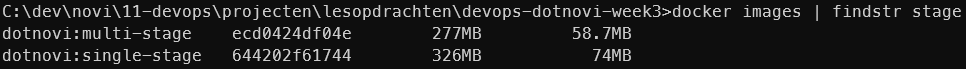

# Opdracht 1

Tijdens de bonusopdrachten uit week/les2 heb ik de Dockerfile al omgezet tot een multi-stage build. Daarom heb ik een
[single-stage Dockerfile](/Dockerfile.single-stage) neergezet om de vergelijking alsnog tijdens deze opdracht te kunnen
maken.

Het uiteindelijke verschil:
