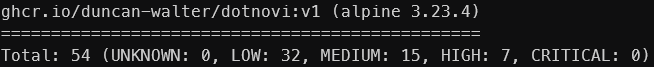
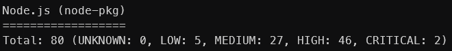

# Leermomenten

## Leermoment 1
`docker login` i.c.m. GitHub Container Registry (ghcr) verwacht een classic PAT die eerst in GitHub aangemaakt moet worden (er zijn ook andere mogelijkheden bijv. de GitHub CLI).

Wanneer de PAT is aangemaakt kan deze bijvoorbeeld tijdelijk als environment variabel geset worden met (Windows):
```bash
set GHCR_PAT=<PAT value>
```

Daarna kan er regulier worden ingelogd met (Windows):
```bash
echo %GHCR_PAT% | docker login ghcr.io -u <username value> --password-stdin
```

## Leermoment 2
`docker push ghcr.io/<username value>/dotnovi:v1` maakt een private package op account niveau aan zonder deze aan de repository te koppelen (wat in CI eenvoudig gedaan kan worden volgens de documentatie). De private package kan alsnog handmatig via de GitHUB UI worden gekoppeld aan de repository.

## Leermoment 3
`docker run aquasec/trivy image dotnovi:v1` werkt niet out-of-the-box met de huidige set-up. Dat komt omdat:
1. De package (image) private is.
2. De aquasec/trivy image probeert de target image op Docker Hub te vinden terwijl deze op de GHCR staat.

Binnen aquasec/trivy bestaan environment variabelen om authenticatie naar private resources mogelijk te maken. Hierdoor kunnen we bijde private package (image).

Daarnaast kan de namespace van de image expliciet worden aangegeven: `ghcr.io/duncan-walter/dotnovi:v1` i.p.v. `dotnovi:v1`. Dit zorgt ervoor dat aquasec/trivy de image binnen GHCR opzoekt.

Hierdoor heb ik met het volgende commando succesvol lokaal een  security scan uitgevoerd.
```bash
docker run --rm -e TRIVY_USERNAME=duncan-walter -e TRIVY_PASSWORD=%GHCR_PAT% aquasec/trivy image ghcr.io/duncan-walter/dotnovi:v1
```

Dit heeft voor het volgende resultaat gezorgd (zonder details):

Image:


Node dependencies:
